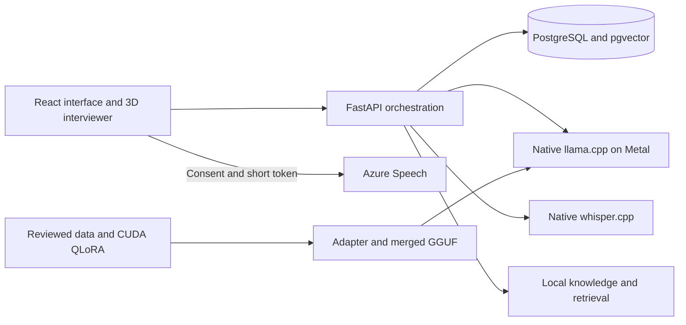

# VoxPrep HK

## Executive summary

VoxPrep HK is a local interview practice application for Hong Kong technology graduates. Paste a job description, choose English or Cantonese, answer an adaptive interview, then review STAR evidence and source-linked coaching. A React interface and original 3D interviewer connect to a FastAPI backend. The application supports real local Qwen inference, Azure Speech with consent, local Whisper transcription, and a clearly labelled deterministic demonstration provider. This repository also contains QLoRA training and evaluation workflows. Training quality, human review, speech accuracy and usability must be established with actual runs and participants before the full implementation plan is complete. See [PROGRESS.md](PROGRESS.md) for verified results and remaining gates.

## Quick start

Requires Python 3.12+, Node 22+, pnpm 11.25+, and about 5 GB free space for inference models. Docker Desktop supplies PostgreSQL 17 and pgvector. On macOS, Homebrew supplies native llama.cpp, whisper.cpp, and FFmpeg. The app remains runnable in an explicitly labelled demo mode without cloud credentials or model weights.

```sh
make bootstrap
make dev
```

Bootstrap installs Python and frontend dependencies, native tools when Homebrew is available, and four pinned public model artifacts with SHA-256 verification. It downloads approximately 4.35 GB. Inference runs on the Mac; CUDA training runs separately in Colab or Kaggle. Open [the development interface](http://localhost:5173).

For a fast code-only setup without downloading models:

```sh
python3.12 -m venv .venv
.venv/bin/pip install -r requirements.lock
.venv/bin/pip install --no-deps -e backend
pnpm --dir frontend install --frozen-lockfile
pnpm --dir e2e install --frozen-lockfile
MODEL_PROVIDER=demo VOXPREP_SQLITE=1 make dev
```

For the production frontend through a single [localhost endpoint](http://localhost:8000):

```sh
make demo
```

`make dev` and `make demo` start available local models and use PostgreSQL when Docker is running. They use SQLite when Docker is unavailable. `Ctrl+C` stops processes started by the command. PostgreSQL data persists in a Docker volume. `make stop-container` stops Compose services without deleting their volume.

## Configuration and real services

Copy `.env.example` to `.env` if custom configuration is required. This file is ignored by Git and excluded from the source archive. Environment variables take precedence.

- Set `MODEL_PROVIDER=llama` to use the local Qwen base model or your genuinely trained model at `MODEL_PATH`. With no explicit provider, the supervisor selects llama when weights are present. The default backend provider is `demo` when run directly.
- Set `AZURE_SPEECH_KEY` and `AZURE_SPEECH_REGION` locally for Azure Speech. The browser receives only a short-lived authorization token after consent. Audio/text goes to Azure only for the selected cloud voice feature.
- Configure `EMBEDDING_BASE_URL` and `RERANKER_BASE_URL` for model retrieval. Health and methodology identify lexical fallback and unavailable services.
- Set `DATABASE_URL` to an explicit SQLAlchemy URL if required. The Compose PostgreSQL port is `127.0.0.1:54329`, isolated from common local databases.
- Native inference services listen on loopback at ports 8080 (LLM), 8081 (Whisper), and 8082 (embeddings), and 8083 (reranking).

`make demo-container` builds the application container with PostgreSQL. Native Metal inference stays on the host. Docker Desktop must be able to reach host services through `host.docker.internal`. For retrieval in the container, set `CONTAINER_EMBEDDING_BASE_URL=http://host.docker.internal:8082/v1` and `CONTAINER_RERANKER_BASE_URL=http://host.docker.internal:8083/v1`; host loopback URLs are not reused inside containers. The default container uses demo mode until explicitly configured. The local-only database password in Compose is a development fixture; this stack is not a public deployment configuration.

## Commands

| Command | Result |
| --- | --- |
| `make bootstrap` | Install application dependencies, supported native tools and verified model files |
| `make dev` | Start frontend, API, database and available native models |
| `make demo` | Build frontend and serve the app through port 8000 |
| `make test` | Lint, backend/tooling tests, frontend tests/build, browser journeys and axe checks |
| `make eval` | Run explicitly labelled offline evaluation smoke checks |
| `make demo-reset` | Replace only the seeded demonstration session through the local API |
| `make package` | Create a source ZIP and checksum, excluding secrets, personal sessions and model weights |
| `make models` | Download and checksum pinned inference models |

For browser tests, install Chromium once with `pnpm --dir e2e exec playwright install chromium`. `make test` uses a separate SQLite database under `artifacts/`. It does not require Azure credentials or model weights. Full release evaluation is separate from deterministic checks; see [the evaluation guide](docs/EVALUATION.md).

## Features and boundaries

- TXT, text PDF and DOCX job descriptions with size/type validation and scanned-document rejection.
- English and Traditional Chinese Cantonese interview turns with selectable difficulty and 3, 5 or 8 questions.
- Adaptive follow-ups, editable transcripts, pause/resume, skip/retry and typed fallback.
- Original procedural 3D interviewer, speech animation, reduced-motion and static fallback.
- STAR evidence, competency citations, speech summaries, practice history, two-session comparison, full transcript/report export and deletion.
- Structured model output validation, local retrieval and explicitly reported fallback behavior.
- Dataset provenance and review gates, a QLoRA notebook and scripts, and evaluation pipelines.

The coach does not score emotion, appearance, accent quality, personality, protected traits or employability. It does not make hiring decisions. Keyword-based fallback analysis is approximate and is labelled in reports. A citation identifies a source passage; citation presence alone does not prove that a generated claim is supported.

## Architecture and contracts

See [architecture](docs/ARCHITECTURE.md), [API contract](contracts/API.md), [the supplied implementation plan](docs/ORIGINAL_PLAN.md), [model card](docs/MODEL_CARD.md), and [dataset guide](docs/DATASET.md).



## Training and evaluation

The supplied model is a public base model quantization. It is not a VoxPrep fine-tuned checkpoint. The draft data is synthetic and must pass human review before training. Follow [ml/](ml/) and [docs/DATASET.md](docs/DATASET.md) to review, split, train, preserve checkpoints, export, and measure base versus LoRA performance. Keep reviewed data, hashes, logs, loss curves, manifests and raw results with the final submission.

No target percentage in the original plan is a measured result. Azure Speech and a training GPU are not yet set up; follow [the external setup guide](docs/EXTERNAL_SETUP.md) when ready. The methodology screen reads stored evaluation evidence and labels pending work. Participant speech recordings, blinded preference ratings, and usability studies cannot be replaced by generated test fixtures.

## Troubleshooting

- **No model / timeout:** check `artifacts/run/llama.log`, run `make models`, or set `MODEL_PROVIDER=demo` for the deterministic rehearsal. No fallback is evidence of fine-tuning.
- **Docker unavailable:** start Docker Desktop, or use `VOXPREP_SQLITE=1` for local development.
- **Microphone unavailable:** keep typing, or enable microphone access for localhost. Cloud speech additionally requires explicit consent and configured credentials.
- **Whisper cannot read browser audio:** ensure FFmpeg is installed; the native server uses `--convert`.
- **Port in use:** stop the previous VoxPrep process rather than starting another on the same port.
- **Scanned PDF:** paste the visible job description text. OCR is outside scope.
- **WebGL unavailable:** use the static interviewer or disable the avatar. Interview controls and captions remain available.
- **Browser test version mismatch:** run the Playwright browser installation command above with the locked dependencies.

## Submission and team

The course requires a source ZIP, a PowerPoint file, a seven-minute English presentation, and team identities in this README. The source package is written to `artifacts/VoxPrep-HK-source.zip`. Presentation and demo materials are in `presentation/`. Review [the release checklist](docs/RELEASE_CHECKLIST.md) before submission.

| Team member | English name | Student ID | Planned responsibility |
| --- | --- | --- | --- |
| 1 | SO Ngai Chun | 26131699D | Product, UI, avatar |
| 2 | SHIH Richard | 25015663D | Speech and audio evaluation |
| 3 | WONG Kin Chung | 24065065D | Dataset, training, model evaluation |
| 4 | YUEN Yiu Yeung | 23000594D | Backend, retrieval, reliability |

Responsibilities are proposed allocations, not claims of completed student contributions. Each student should record actual work and cross-review before submission.
